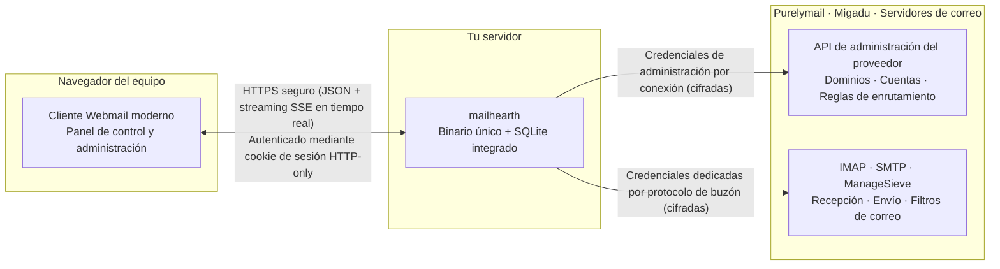

# Mailhearth

[English](README.md) · [简体中文](README.zh-CN.md) · [繁體中文](README.zh-TW.md) · [日本語](README.ja.md) · **Español**

**Mailhearth** es una plataforma de correo electrónico profesional autoalojada y ligera, diseñada específicamente para equipos pequeños (de 1 a 50 personas): startups, profesionales independientes, estudios creativos y pequeñas organizaciones. Permite unificar en un solo lugar proveedores como Purelymail, Migadu y servidores de correo IMAP/SMTP estándar o propios, integrando la estructura de la organización, los roles de miembros, buzones personales y compartidos, alias, grupos de distribución, dominios personalizados y un cliente webmail moderno y rápido.

En el diseño de la arquitectura, los servidores de correo externos se concentran en lo esencial: transporte de protocolos, entrega confiable y almacenamiento físico de los mensajes. Por su parte, Mailhearth actúa como capa superior, gestionando el modelo organizativo del equipo, permisos de acceso detallados, la administración operativa diaria y una experiencia de usuario fluida y agradable. Las credenciales de API de administración del proveedor y las contraseñas de los protocolos de cada buzón se mantienen estrictamente aisladas y cifradas de forma individual.



Mailhearth cumple rigurosos estándares de seguridad y aislamiento: las consultas habituales de administración jamás devuelven contraseñas de protocolos ni tokens de API en texto plano. Las nuevas contraseñas de aplicación generadas para clientes de correo externos se entregan únicamente a administradores autorizados a través de un procedimiento seguro de reclamo único y con tiempo límite.

| Cliente Webmail | Panel de administración |
|---|---|
|  |  |
|  |  |

<sub>Nota: Las capturas de pantalla mostradas fueron tomadas manualmente en el entorno local de demostración incluido con la documentación. Reflejan el diseño y la interacción de la interfaz y no una validación frente a proveedores reales.</sub>

## Qué obtienes

**Para propietarios y administradores de equipo**

- **Asistente de configuración inicial sin fricción**: Crea tu organización y conecta tus proveedores de correo con facilidad. Detecta recursos remotos existentes con un solo clic, impórtalos de forma selectiva y configura las credenciales de cada buzón, o completa la inicialización sin vincular un buzón personal. La importación de recursos es de solo lectura y no altera destructivamente los datos del proveedor.
- **Gestión de miembros centrada en las personas**: Administra a tus colaboradores de manera intuitiva y humana: nombre, rol, departamento, creación de nuevos buzones o vinculación de cuentas existentes, concesión de acceso a buzones compartidos, asignación a grupos y generación de enlaces de invitación seguros y con caducidad.
- **Buzones compartidos para trabajo colaborativo**: Permite que varios miembros atiendan juntos buzones públicos como soporte (`support@`) o ventas (`sales@`) sin compartir ni exponer nunca la contraseña real. Los niveles de acceso se definen con precisión: «Acceso total», «Lectura y envío» o «Solo lectura».
- **Gestión completa y flexible de direcciones**: Soporte nativo para alias, reenvío de correo (Forwarding), direcciones catch-all, enrutamiento por prefijo y grupos de distribución dinámicos que se actualizan automáticamente cuando cambian los miembros del equipo.
- **Flujos ordenados de salida y traspaso (Offboarding)**：Registra y ejecuta con seguridad cada paso de la desvinculación: traspaso fluido del buzón a un sucesor o archivado para conservación histórica, eliminación automática de grupos y revocación inmediata de todas las sesiones web activas. Si el proveedor admite la revocación remota, el sistema ayuda en el proceso y registra el informe de finalización del administrador.
- **Supervisión de dominios y salud de DNS**: Monitorea de forma visual el estado de configuración DNS (MX, SPF, DKIM, DMARC) con indicadores claros de superado o pendiente, e incluye los valores de los registros listos para copiar y pegar.
- **Roles granulares y registro de auditoría completo**: Roles prediseñados y personalizados con permisos detallados, historial de auditoría inmutable de todas las acciones sensibles y transferencia sencilla de la propiedad de la organización.

**Para todos los usuarios**

- **Webmail moderno, rápido y adaptable**: Carpetas de sistema y personalizadas, navegación paginada, búsqueda ultrarrápida en el servidor, mensajes destacados con estrella, acciones masivas, vista previa y descarga de adjuntos, autoguardado de borradores en tiempo real, editor de texto enriquecido, firmas personalizadas, múltiples identidades de remitente, notificaciones de escritorio mediante IMAP IDLE, atajos de teclado globales, temas claro y oscuro, y una interfaz totalmente localizada en 5 idiomas.
- **Colaboración en buzones compartidos**: Estado visual claro en cada conversación: comprueba si algún compañero ya ha respondido, asigna mensajes a responsables concretos, marca temas como resueltos y añade notas internas privadas visibles solo para el equipo.
- **Reglas automáticas y respuestas de vacaciones**: En servidores compatibles con ManageSieve, configura filtros avanzados y respuestas automáticas por ausencia. Mailhearth conserva los scripts preexistentes en el servidor y solicita confirmación expresa antes de asumir el control del script activo.
- **Garantías sólidas de entrega de correo**: Las operaciones de envío guardan por separado el traspaso a SMTP y el archivado de la copia en la carpeta Enviados (Sent). Si el resultado de la entrega es incierto, jamás se reintenta a ciegas para evitar duplicados al destinatario; ante un fallo al guardar la copia, solo se reintenta el guardado local sin reenviar por SMTP.

**Arquitectura de seguridad robusta**

- **Cifrado completo en reposo**: Todas las credenciales de API de gestión y las contraseñas de los protocolos de correo se cifran en la base de datos con AES-256-GCM. Las claves de cifrado se derivan de forma segura desde la clave maestra (`master.key`) del servidor y nunca se envían al navegador.
- **Aislamiento estricto de contenido en sandbox**: El HTML de los correos se desinfecta minuciosamente en el servidor y se representa dentro de un iframe aislado (sandbox) sin scripts, bajo una estricta Política de Seguridad de Contenido (CSP). Las imágenes remotas externas se bloquean de forma predeterminada para evitar rastreos y solo se cargan si el usuario lo solicita; los archivos adjuntos se sirven con la cabecera `X-Content-Type-Options: nosniff` y en modo de descarga segura.
- **Protección corporativa integrada**: Defensas automáticas contra CSRF, limitación de tasa de intentos de inicio de sesión para mitigar ataques de fuerza bruta, hash de contraseñas de última generación con argon2id y registro de auditoría inmutable.

## Requisitos del sistema

- **Servicio de correo**: Una cuenta en Purelymail o Migadu para aprovisionamiento automatizado mediante API, o buzones estándar propios/terceros con credenciales IMAP/SMTP (ManageSieve es opcional).
- **Servidor ligero**: Un servidor o VPS Linux estándar (512 MB de RAM son más que suficientes; el binario consume unos 30 MB en reposo) y un proxy inverso para la terminación TLS (se recomienda Caddy, Nginx o Traefik).

## Puesta en marcha rápida

Con Docker Compose (recomendado):

```bash
git clone https://github.com/yll682/Mailhearth.git && cd Mailhearth
cp .env.example .env            # Edita .env y define MAILHEARTH_BASE_URL con tu dominio público
docker compose up -d --build
```

Una vez en marcha, abre en el navegador la URL pública configurada y sigue el asistente inicial para crear la cuenta de administrador, conectar tu proveedor de correo e importar los buzones necesarios. Antes de comenzar a enviar y recibir correo, asegúrate de verificar las credenciales de cada protocolo.

> **Aviso de copia de seguridad**: Asegúrate de respaldar regularmente el volumen persistente `/data`. Contiene la base de datos SQLite y la clave maestra de cifrado `master.key`.

Si prefieres ejecutar directamente el binario compilado, al ejecutar `make build` se generará un ejecutable autónomo `mailhearth` que contiene todos los recursos web estáticos integrados. Inícialo con `MAILHEARTH_DATA_DIR=/var/lib/mailhearth ./mailhearth`.

## Conectar un buzón IMAP/SMTP existente

En el panel de administración, selecciona «Conexión manual», registra la dirección de correo completa e introduce el nombre de host, puerto, modo de cifrado TLS y contraseña para los protocolos habilitados (IMAP, SMTP y, si está disponible, ManageSieve).

- IMAP y SMTP pueden utilizar nombres de usuario y contraseñas completamente diferentes.
- Si el servidor de correo no ofrece soporte para ManageSieve, simplemente desactiva esa opción en la configuración.
- La validación de certificados TLS utiliza por defecto los certificados de confianza del sistema operativo, permitiendo además configurar paquetes de certificados de CA privados si fuera necesario.
- La importación de reglas de reenvío conserva el buzón de origen, el estado de confirmación de cada destino y las referencias remotas. Los modos de entrega sin verificar se marcan como `unverified`; las operaciones de escritura de reenvíos en Migadu requieren superar la prueba de entrega.

## Configuración del sistema

Mailhearth sigue los principios 12-Factor y todas sus opciones se configuran mediante variables de entorno (ver [`.env.example`](.env.example)). En la gran mayoría de despliegues en producción solo necesitarás configurar:
- `MAILHEARTH_BASE_URL`: La URL pública completa y accesible con la que los usuarios entrarán a Mailhearth.
- `MAILHEARTH_TRUST_PROXY`: Ponlo en `true` detrás de un proxy inverso para que la dirección del cliente se lea de `X-Forwarded-For`. Las cabeceras de reenvío solo se aceptan de los pares indicados en `MAILHEARTH_TRUSTED_PROXIES` (por defecto: loopback y redes privadas).

Los valores mal formados o fuera de rango detienen el arranque con un error que indica la variable. Todas las opciones, incluidas las cuotas de subida, la duración de las sesiones, las listas de redes permitidas para servidores de correo y las CA privadas, se describen en el [Manual de operaciones](docs/operations.es.md), sección «Referencia de configuración».

## Documentación técnica detallada

- [Guía de arquitectura](docs/architecture.es.md): Componentes internos de Mailhearth, modelo de dominio, capa de abstracción de conexiones de correo y tareas persistentes asíncronas.
- [Especificación de seguridad](docs/security.es.md): Modelo de amenazas, defensas en profundidad y controles de seguridad implementados.
- [Manual de operaciones](docs/operations.es.md): Procedimientos de mantenimiento, respaldo y restauración de bases de datos, actualizaciones sin interrupciones y resolución de incidencias.
- [Registro de cambios](CHANGELOG.es.md): Historial de versiones con novedades, mejoras de usabilidad y corrección de errores.

## Desarrollo y contribución

```bash
go test ./... -run '^$'
go test -count=1 ./... -run '^TestMultiProvider'
go vet ./...
npm --prefix web run typecheck
npm --prefix web run test
npm --prefix web run build
cd web && npm run dev           # Servidor de desarrollo Vite con proxy automático de /api hacia :8080
```

Tecnologías utilizadas: Go 1.27 + Preact + Vite + SQLite (controlador Go nativo, sin dependencias cgo). Todo el código de backend y frontend se distribuye compilado en un único ejecutable.

La interfaz web incluye soporte nativo para inglés, chino simplificado, chino tradicional, japonés y español. Las definiciones de cadenas se encuentran en [`web/src/lib/i18n.ts`](web/src/lib/i18n.ts), tomando el inglés como idioma base. Para añadir un nuevo idioma solo se requiere incorporar su diccionario y declararlo en el selector. El script de prueba `web/tests/i18n.test.mjs` verifica automáticamente la cobertura de traducciones y la coherencia de las variables en las plantillas.

## Licencia

Distribuido bajo los términos de la licencia de código abierto MIT. Consulta el archivo [LICENSE](LICENSE) para más detalles.
