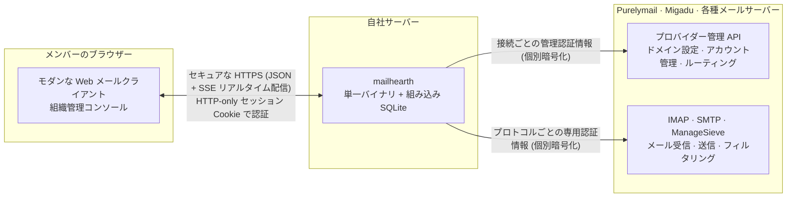

# Mailhearth

[English](README.md) · [简体中文](README.zh-CN.md) · [繁體中文](README.zh-TW.md) · **日本語** · [Español](README.es.md)

**Mailhearth** は、小規模チーム（1〜50人）向けに設計された軽量なセルフホスト型ビジネスメール基盤です。スタートアップ、個人開発者・一人会社、クリエイティブスタジオ、小規模組織に最適です。Purelymail、Migadu、および標準的な IMAP/SMTP メールサーバーを一元的に接続し、組織構造、メンバーロール、個人メールボックス、共有メールボックス、エイリアス、グループ配信リスト、カスタムドメイン、そして洗練された最新の Web メールクライアントを単一のシステムに統合します。

システム設計において、基盤となるメールサーバーはメッセージの安定した送受信、プロトコル転送、および永続ストレージを担当します。Mailhearth はその上位に位置し、組織モデル、きめ細かなアクセス権限、日々の管理運用、そして快適なユーザー体験を提供します。プロバイダーの管理 API 認証情報とメールボックスごとのプロトコル認証情報は厳格に分離・暗号化して管理されます。



Mailhearth は厳格なセキュリティ分離基準を順守しています。日常的な管理クエリで保存済みの API トークンやプロトコルパスワードが平文で返されることは決してありません。外部クライアント向けに新しく生成されたアプリ専用パスワードは、権限を持つ管理者が期間限定の明示的なワンタイム受け取り手順を通じて取得します。

| Web メールクライアント | 管理コンソール |
|---|---|
|  |  |
|  |  |

<sub>注: 上記のスクリーンショットはローカルの内蔵ドキュメント用デモ環境で手動撮影されたものであり、UI のレイアウトと操作感を示すものです。実環境のメールプロバイダーによる検証結果を表すものではありません。</sub>

## 主な機能と特徴

**チーム管理者向け**

- **シンプルな初回セットアップウィザード**: 組織の作成からメールプロバイダーの接続までスムーズに完了。ワンクリックでリモートのリソースを検出し、必要なアカウントを選択して取り込みます。メールボックスの紐付けをスキップして初期化を完了することも可能です。リソースの取り込みは完全な読み取り専用であり、リモートデータを破壊することはありません。
- **「人」を中心とした直感的なメンバー管理**: 氏名、ロール、所属部署、専用メールボックスの新規作成または既存メールボックスの割り当て、共有メールボックスへのアクセス権付与、グループへの追加、安全な有効期限付き招待リンクの発行など、直感的なメンバー運用が行えます。
- **複数人で共同運用できる共有メールボックス**: カスタマーサポート（`support@`）や営業窓口（`sales@`）などの代表メールを、実際のパスワードを共有することなくチーム全員で対応できます。権限は「フルアクセス」「送信・閲覧」「閲覧のみ」から柔軟に設定可能です。
- **柔軟で強力なアドレス管理**: エイリアス、メール転送、キャッチオール、プレフィックスアドレスに対応。グループメンバーの変更に自動で連動する配信グループアドレスも利用可能です。
- **安全で確実な退職・引き継ぎフロー（Offboarding）**: メンバーの退職に伴うタスクを漏れなく確実に処理——メールボックスの後任への引き継ぎまたはアーカイブ保持、グループからの自動脱退、アクティブな全セッションの即時失効。プロバイダーがリモートでのアクセス権失効に対応している場合、失効の実行と管理者の完了報告を確実に記録します。
- **ドメインと DNS レコードの健全性監視**: 独自ドメインの DNS 設定状況（MX、SPF、DKIM、DMARC）を視覚的に監視し、コピー＆ペースト可能な標準 DNS レコード値を提供します。
- **詳細な権限管理と監査ログ**: 柔軟なロールベースアクセス制御（RBAC）を標準装備。すべての重要な管理操作を記録する改ざん耐性のある監査ログを備え、組織所有権のスムーズな移譲にも対応しています。

**すべての利用メンバー向け**

- **高速でレスポンシブなモダン Web メール**: システムフォルダーおよびカスタムフォルダー、ページネーション、サーバーサイド高速検索、スター（フラグ）管理、一括操作、添付ファイルのプレビューとダウンロード、下書きのリアルタイム自動保存、リッチテキスト編集、署名管理、複数の送信者情報（Identity）の切り替え、IMAP IDLE によるデスクトップ通知、キーボードショートカット、ダーク／ライトモード対応、5言語のインターフェース切り替え。
- **共有メールボックスでのチーム協調作業**: メールの対応状況が一目で把握可能——チームメンバーが既に返信したかどうかの確認、メールの担当者割り当て、対応完了（解決済み）ステータスの付与、チーム内だけで共有できる社内メモの記録。
- **メールフィルタールールと自動返信**: ManageSieve に対応したサーバーで、高度な自動振り分けルールや不在時の自動返信を設定可能。サーバー上に既存のスクリプトがある場合は適切に保持され、アクティブなスクリプトを引き継ぐ際には明示的な確認が行われます。
- **確実なメール送信保証**: 送信リクエストは SMTP への引き渡しと送信済みフォルダー（Sent）への保存を個別のステップとして永続化。送信結果が不明な場合に無暗に再送信することはなく、送信済みコピーの保存失敗時にもメール本文が重複送信される心配はありません。

**堅牢なセキュリティ体制**

- **保存データの完全暗号化**: プロバイダーの管理 API 認証情報およびメールボックスのプロトコルパスワードは、サーバー側の master.key から安全に導出された鍵を用いて AES-256-GCM で強力に暗号化されます。認証情報がブラウザー側に漏洩することはありません。
- **徹底したコンテンツサンドボックス**: メールの HTML 本文はサーバー側で厳密に無害化され、厳格な Content Security Policy (CSP) が適用されたスクリプト無効のサンドボックス iframe 内で安全に描画されます。外部画像はトラッキング防止のため初期状態でブロックされ、ユーザーの明示的な操作でのみ読み込まれます。添付ファイルは `X-Content-Type-Options: nosniff` ヘッダー付きで安全なダウンロード専用として提供されます。
- **強固な基本防御**: CSRF 対策、ブルートフォース攻撃を防ぐログイン試行制限、argon2id によるパスワードハッシュ化、改ざん防止の監査ログを完備。

## 動作要件

- **対応メールサービス**: API 自動管理用の Purelymail または Migadu アカウント。または IMAP/SMTP 認証情報を備えた一般的な自作／外部メールサーバー（ManageSieve は任意）。
- **軽量なサーバー環境**: 一般的な Linux サーバー（メモリ 512 MB で快適に動作します。待機時のバイナリメモリ消費は約 30 MB 程度）、および TLS 証明書を終端するリバースプロキシ（Caddy、Nginx、Traefik を推奨）。

## クイックスタートと導入

Docker Compose を利用する場合（推奨）:

```bash
git clone https://github.com/yll682/Mailhearth.git && cd Mailhearth
cp .env.example .env            # .env を編集し、MAILHEARTH_BASE_URL に公開 URL を設定
docker compose up -d --build
```

起動後、設定した公開 URL にブラウザーでアクセスし、初回ウィザードに従って組織管理者アカウントを作成、メールプロバイダーを接続してリソースを取り込みます。メールの送受信を開始する前に、各プロトコルの認証情報が正しく設定・検証されていることを確認してください。

> **バックアップに関する注意**: `/data` ボリュームにはシステムの主要データである SQLite データベースファイルと暗号化マスターキー `master.key` が保存されています。定期的なバックアップを必ず実施してください。

単一バイナリとして直接実行したい場合、`make build` を実行することで Web 静的アセットを内包したスタンドアロンの実行可能ファイル `mailhearth` が生成されます。`MAILHEARTH_DATA_DIR=/var/lib/mailhearth ./mailhearth` で直接起動可能です。

## 既存の IMAP/SMTP メールボックスを利用する

管理コンソールで「手動接続」を選択し、完全なメールアドレスを登録した上で、有効にする IMAP、SMTP（および任意の ManageSieve）のホスト名、ポート番号、TLS 暗号化モード、パスワードを入力します。

- IMAP と SMTP でそれぞれ独立したユーザー名とパスワードを使用できます。
- サーバーが ManageSieve に対応していない場合は、設定で無効化するだけで問題ありません。
- TLS 証明書の検証にはシステムの信頼済み CA 証明書を使用しますが、明示的なプライベート CA 証明書バンドルの指定にも対応しています。
- 転送ルールの取り込みでは、転送元、各転送先の確認ステータス、およびリモートの参照関係が正確に保持されます。未検証の配信方式は `unverified` と表示され、Migadu の転送書き込みには厳格な配信検証が必要となります。

## システム設定

Mailhearth は 12-Factor 原則に準拠しており、すべての設定は環境変数で管理されます。詳細は [`.env.example`](.env.example) を参照してください。一般的な本番運用で設定が必要となるのは基本的に以下の2点のみです:
- `MAILHEARTH_BASE_URL`: ユーザーが Mailhearth にアクセスするための完全な公開 URL。
- `MAILHEARTH_TRUST_PROXY`: リバースプロキシの背後で動かす場合は `true` に設定し、クライアントのアドレスを `X-Forwarded-For` から読み取ります。転送ヘッダーは `MAILHEARTH_TRUSTED_PROXIES` に列挙されたプロキシ（既定値：ループバックとプライベートネットワーク）からのリクエストでのみ信頼されます。

値の形式が不正な場合や範囲外の場合、起動時に該当する変数名を示すエラーで停止します。アップロード容量、セッション有効期間、メールサーバーのネットワーク許可リスト、プライベート CA を含むすべての設定項目は、[運用マニュアル](docs/operations.ja.md)の「設定リファレンス」に記載しています。

## ドキュメント一覧

- [アーキテクチャガイド](docs/architecture.ja.md): Mailhearth の内部コンポーネント、ドメインモデル、メール接続の抽象化レイヤー、非同期タスク管理の詳細。
- [セキュリティ仕様書](docs/security.ja.md): 脅威モデル、多層防御メカニズム、運用上のセキュリティ対策。
- [運用・保守マニュアル](docs/operations.ja.md): バックアップと復元手順、シームレスなバージョンアップ、容量計画、トラブルシューティング。
- [変更履歴](CHANGELOG.ja.md): リリースごとの新機能、改善点、バグ修正の記録。

## 開発に参加する

```bash
go test ./... -run '^$'
go test -count=1 ./... -run '^TestMultiProvider'
go vet ./...
npm --prefix web run typecheck
npm --prefix web run test
npm --prefix web run build
cd web && npm run dev           # :8080 への /api プロキシを備えた Vite 開発サーバーを起動
```

技術スタック: Go 1.27 + Preact + Vite + SQLite（純粋な Go ドライバー、cgo 依存ゼロ）。フロントエンドとバックエンドの全コードが単一のバイナリに凝縮されています。

Web インターフェースは英語、簡体字中国語、繁体字中国語、日本語、スペイン語の5言語にネイティブ対応しています。辞書ファイルは [`web/src/lib/i18n.ts`](web/src/lib/i18n.ts) で管理されており、英語を原本として新しい言語を容易に追加できます。`web/tests/i18n.test.mjs` を実行することで、翻訳の網羅率やパラメーターの対称性を自動検証できます。

## ライセンス

本プロジェクトは MIT ライセンスのもとで公開されています。詳細は [LICENSE](LICENSE) ファイルをご確認ください。
