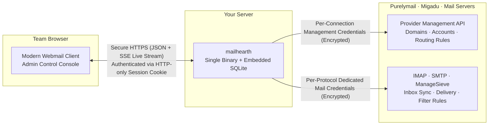
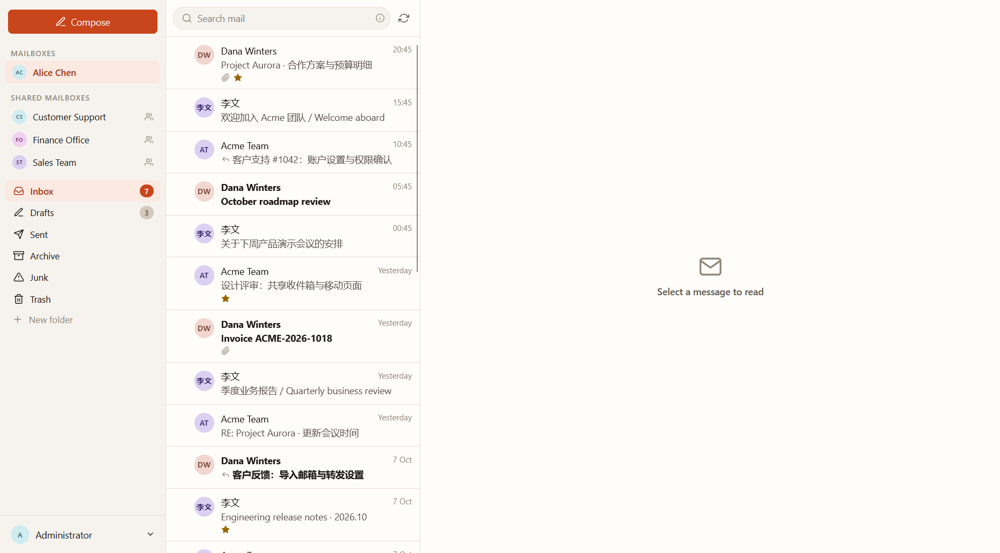
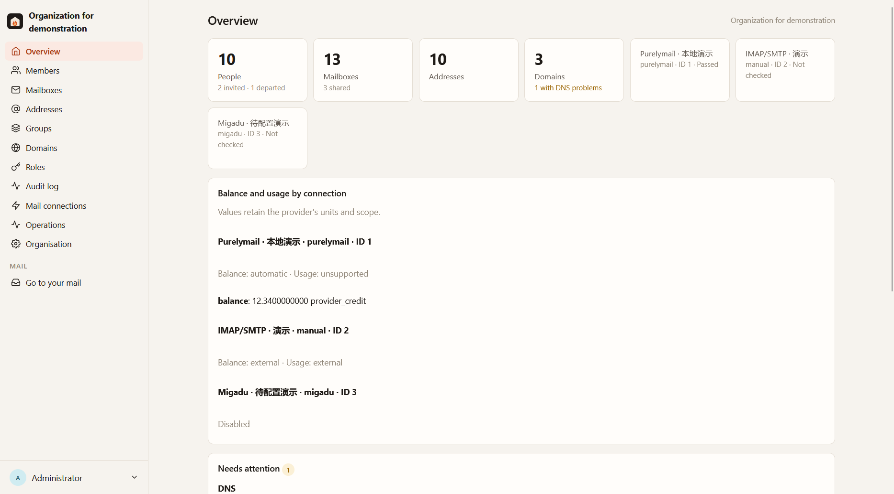
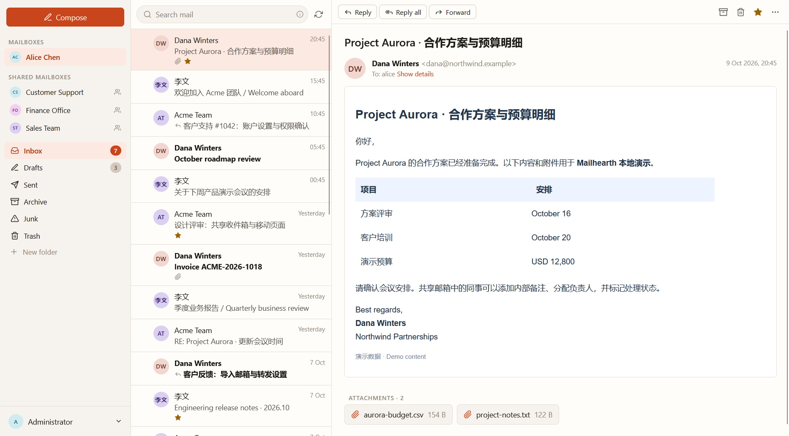
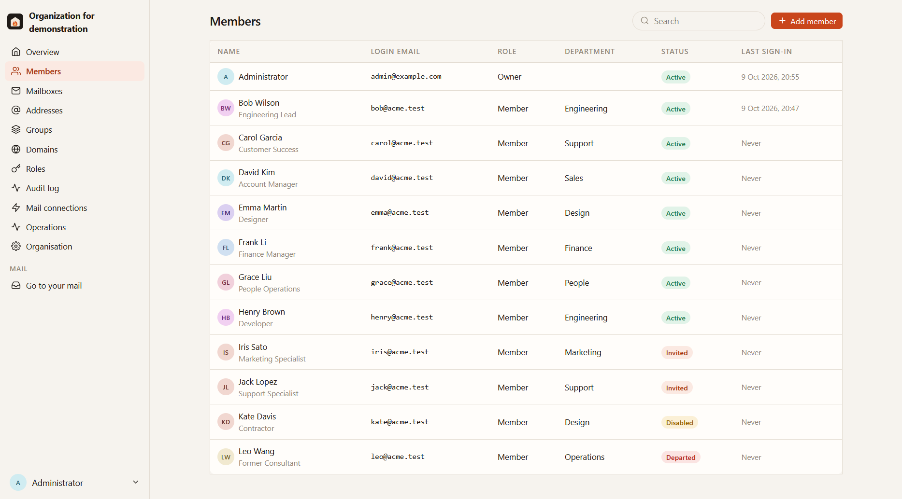

# Mailhearth

**English** · [简体中文](README.zh-CN.md) · [繁體中文](README.zh-TW.md) · [日本語](README.ja.md) · [Español](README.es.md)

**Mailhearth** is a lightweight, self-hosted business email platform designed specifically for small teams (1–50 people): startups, independent founders, digital studios, and compact organizations. It seamlessly unifies Purelymail, Migadu, and custom or standard IMAP/SMTP mail servers into a cohesive workplace, bringing together team members, role-based access, personal and shared mailboxes, aliases, distribution groups, custom domains, and a lightning-fast modern webmail client.

In terms of architecture, external mail servers handle the heavy lifting of message delivery, protocol transport, and permanent storage. Mailhearth operates on top, managing organizational hierarchy, fine-grained access policies, day-to-day administration, and delivering a polished user experience. Provider management API credentials and mailbox protocol passwords are kept strictly isolated and individually encrypted.



Mailhearth rigorously enforces security isolation: routine admin queries will never expose saved API tokens or protocol passwords in plain text. When new application passwords are generated for external third-party mail clients, authorized administrators retrieve them through an explicit, one-time claim flow within a limited time window.

| Webmail Client | Admin Console |
|---|---|
|  |  |
|  |  |

<sub>Note: Screenshots above were manually captured in the local built-in documentation demo environment. They reflect UI layout and design, not validation against live email providers.</sub>

## What You Get

**For Team Owners & Administrators**

- **Effortless First-Run Wizard**: Quickly set up your organization and mail connections, discover remote resources with a single click, selectively import accounts, and configure mailbox credentials—or complete setup without binding a personal mailbox. Resource imports are strictly read-only and never alter upstream data destructively.
- **People-First Member Onboarding**: Manage teammates intuitively as real people—name, role, department, provisioning new mailboxes or binding existing ones, granting shared mailbox access, assigning groups, and sharing secure, time-limited invite links.
- **Collaborative Shared Mailboxes**: Enable multiple team members to manage public mailboxes (`support@`, `sales@`) together without ever sharing or exposing the underlying password. Granular permission tiers include "Full Access", "Send & Read", and "Read Only".
- **Flexible Address Management**: Full support for aliases, email forwarding, catch-all addresses, prefix-based routing, and dynamic distribution groups that stay in sync with team membership automatically.
- **Guided Offboarding Workflows**: Reliably preserve and audit teammate transitions—smoothly transfer mailboxes to a successor or archive them, remove members from active groups, and immediately invalidate all active web sessions. If the mail provider supports remote revocation, Mailhearth tracks and logs the administrator's completion report.
- **Visual Domain & DNS Health**: Continuously monitor DNS records (MX, SPF, DKIM, DMARC) with clear passing/failing indicators, complete with copy-paste DNS record values.
- **Granular Roles & Comprehensive Audit Trail**: Built-in and custom roles with fine-grained permissions, a tamper-evident audit log for all critical actions, and seamless organization ownership transfer.

**For Every Teammate**

- **Fast, Responsive Webmail**: System and custom folders, paginated browsing, instant server-side search, flags, bulk triage, rich attachment previews and downloads, real-time draft autosave, rich text editing, custom signatures, multiple sending identities, desktop notifications via IMAP IDLE, keyboard shortcuts, dark and light modes, and full support for 5 languages.
- **Shared Mailbox Collaboration**: Stay coordinated with clear visual context—see which teammate has already replied, assign conversations to specific owners, mark tickets resolved, and leave internal private notes visible only to your team.
- **Server-Side Rules & Auto-Reply**: Configure automated Sieve mail filters and vacation responders on servers with ManageSieve enabled. Mailhearth preserves existing scripts on the server and requires explicit confirmation before taking over active scripts.
- **Reliable Sending Guarantees**: Sending operations persist SMTP handoff and Sent-copy archival as independent steps. Unknown delivery results are never blindly retried, and retrying a failed Sent copy will never duplicate the SMTP transmission to recipients.

**Robust Security Architecture**

- **Encryption at Rest**: All provider management credentials and mailbox protocol passwords are encrypted using AES-256-GCM. Encryption keys are securely derived from a server-side master key and never reach the browser.
- **Hardened Content Sandboxing**: Message HTML is sanitized on the server and rendered inside a scriptless, sandboxed iframe governed by a strict Content Security Policy (CSP). Remote tracking images are blocked by default until explicitly allowed, and attachments are delivered with `X-Content-Type-Options: nosniff` in download-only mode.
- **Enterprise-Grade Protection**: Built-in CSRF defenses, brute-force login rate limiting, argon2id password hashing, and an immutable administrative audit log.

## Prerequisites

- **Mail Service**: An account with Purelymail or Migadu for automated API provisioning, or standard custom/third-party mailboxes with IMAP/SMTP credentials (ManageSieve is optional).
- **Lightweight Server**: A modest Linux VPS (512 MB RAM is plenty; the binary idles around 30 MB) and a reverse proxy for TLS termination (Caddy, Nginx, or Traefik recommended).

## Quick Start & Deployment

Using Docker Compose (Recommended):

```bash
git clone https://github.com/yll682/Mailhearth.git && cd Mailhearth
cp .env.example .env            # Set MAILHEARTH_BASE_URL to your public domain
docker compose up -d --build
```

Once up and running, read the one-time setup token from the log (`docker compose logs mailhearth | grep 'FIRST-TIME SETUP'`) — or set your own with `MAILHEARTH_SETUP_TOKEN` — then open your configured public URL and follow the first-run wizard to create your organization administrator, connect your mail provider, and import mailboxes. Ensure protocol credentials are verified before reading or sending email.

> **Backup Notice**: Regularly back up the persistent `/data` volume. It contains your core SQLite database and the primary encryption key `master.key`.

If you prefer running a standalone binary, `make build` compiles a self-contained executable embedding all web assets. Run it with `MAILHEARTH_DATA_DIR=/var/lib/mailhearth ./mailhearth`.

## Using Existing IMAP/SMTP Mailboxes

In the admin console, choose "Manual Connection", register the full email address, and specify the server hostname, port, TLS security mode, and credentials for IMAP, SMTP, and optional ManageSieve endpoints.

- IMAP and SMTP can use distinct usernames and passwords.
- If your mail server lacks ManageSieve support, simply keep that protocol disabled.
- TLS certificates are verified against host system trust stores or custom private CA bundles specified in the configuration.
- Forwarding imports retain source mailboxes, individual destination confirmation statuses, and upstream references. Unverified forwarding rules remain clearly flagged as `unverified`. Migadu forwarding writes require delivery verification.

## Configuration

Following 12-Factor principles, all configuration is managed via environment variables. See [`.env.example`](.env.example) for reference. In standard production deployments, you only need:
- `MAILHEARTH_BASE_URL`: The fully qualified public URL where users access Mailhearth.
- `MAILHEARTH_TRUST_PROXY`: Set to `true` behind a reverse proxy so client addresses are read from `X-Forwarded-For`. Forwarding headers are only honoured from peers listed in `MAILHEARTH_TRUSTED_PROXIES` (default: loopback and private networks).

Invalid or out-of-range values stop startup with an error naming the variable. All options, including upload quotas, session lifetime, mail-server network allow-lists and private CA bundles, are listed in the [Operations Manual](docs/operations.md#configuration-reference).

## In-Depth Documentation

- [System Architecture](docs/architecture.md): Internal subsystems, domain models, mail connection abstractions, and persistent asynchronous tasks.
- [Security Guide](docs/security.md): Threat modeling, defense-in-depth measures, and operational controls.
- [Operations Manual](docs/operations.md): Routine maintenance, database backup/restore procedures, seamless upgrades, and troubleshooting.
- [Changelog](CHANGELOG.md): Detailed release notes, feature additions, improvements, and bug fixes across versions.

## Development

```bash
go test ./... -run '^$'
go test -count=1 ./... -run '^TestMultiProvider'
go vet ./...
npm --prefix web run typecheck
npm --prefix web run test
npm --prefix web run build
cd web && npm run dev           # Vite dev server with automatic /api proxying to :8080
```

Stack: Go 1.27 + Preact + Vite + SQLite (pure-Go driver, zero cgo). The entire application compiles into a single, compact binary.

The web client natively supports English, Simplified Chinese, Traditional Chinese, Japanese, and Spanish. String dictionaries reside in [`web/src/lib/i18n.ts`](web/src/lib/i18n.ts), with English as the canonical source. Adding a language requires only an additional dictionary mapping and an entry in the switcher. Automated tests in `web/tests/i18n.test.mjs` validate translation coverage and template interpolation symmetry.

## License

Released under the permissive MIT License. See [LICENSE](LICENSE) for full details.
