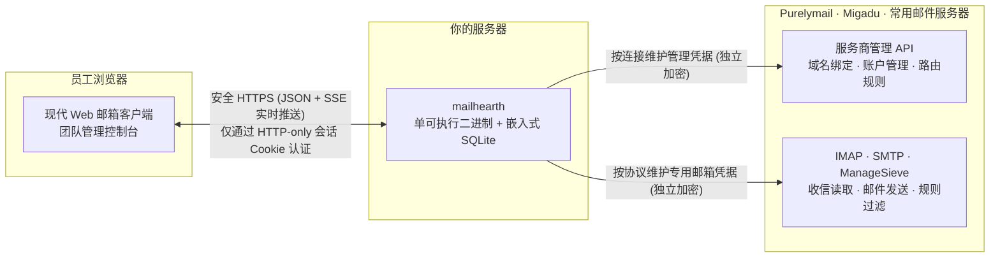
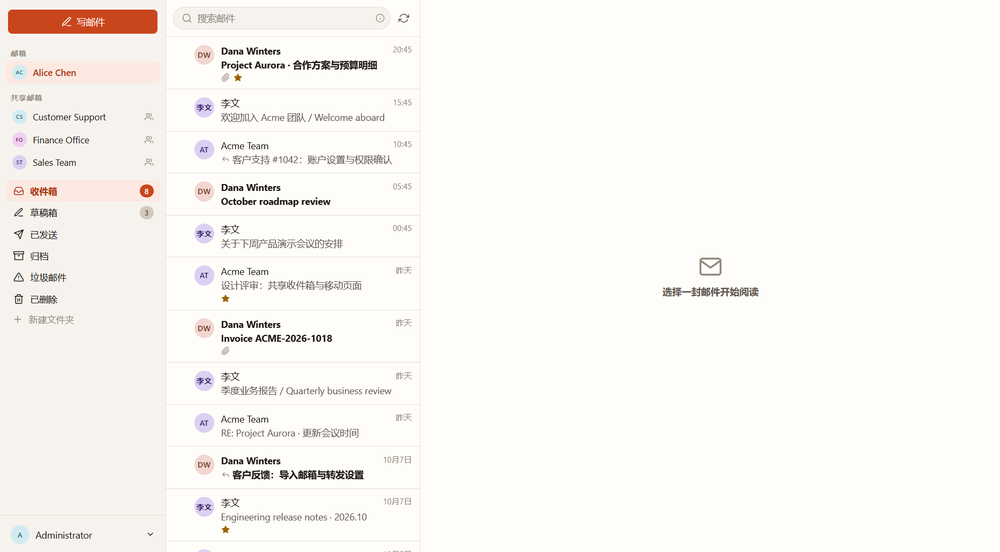
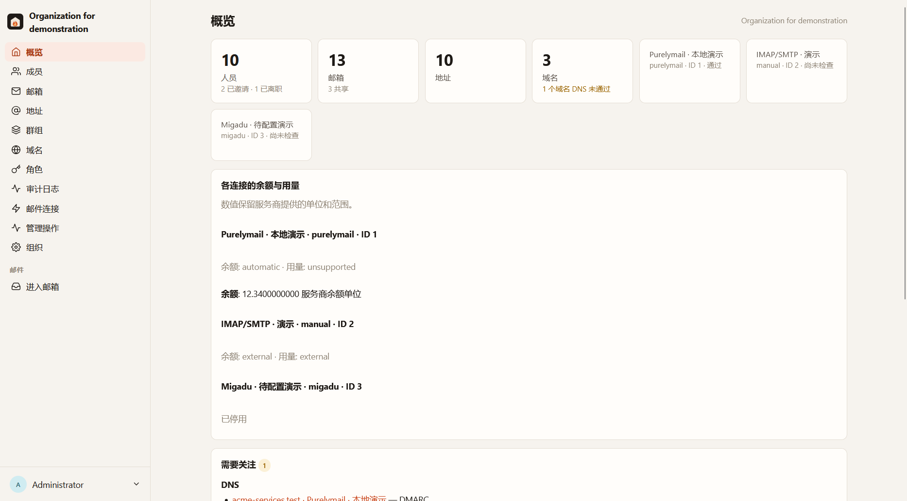
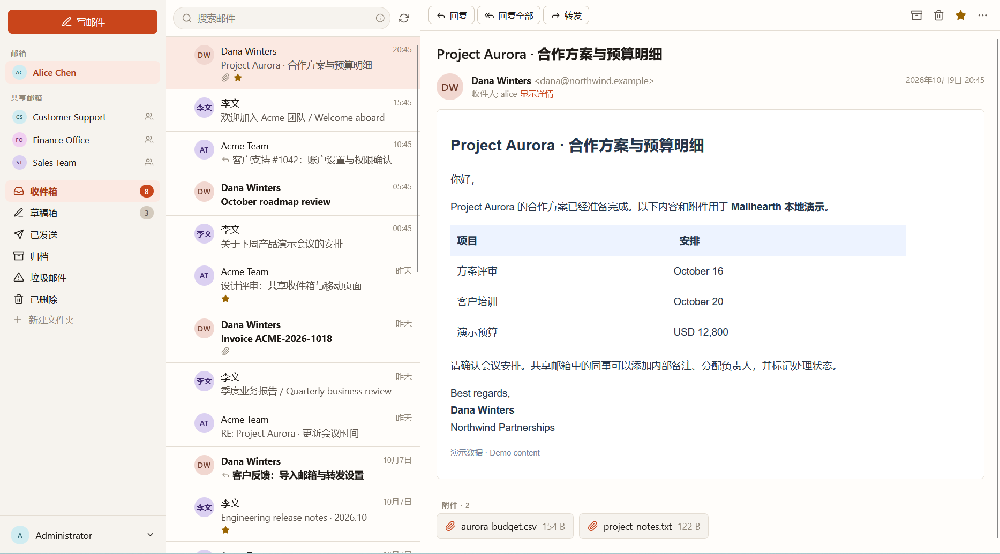
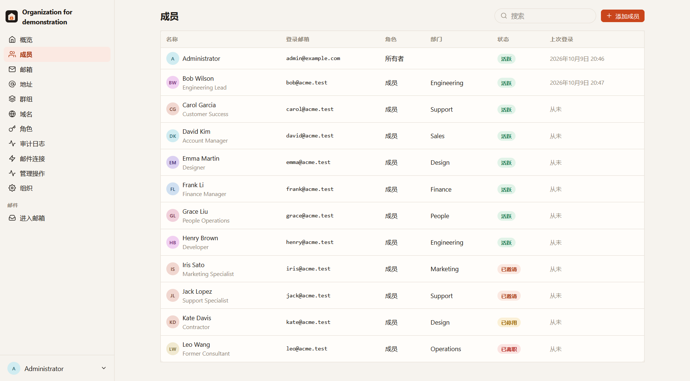

# Mailhearth

[English](README.md) · **简体中文** · [繁體中文](README.zh-TW.md) · [日本語](README.ja.md) · [Español](README.es.md)

**Mailhearth** 是专为小型团队（1–50 人）量身打造的轻量级自托管商务邮箱平台，特别适合初创公司、独立开发者、工作室及小微组织。它能够统一连接 Purelymail、Migadu 以及自建或标准 IMAP/SMTP 邮件服务器，将组织架构、成员角色、个人邮箱、团队共享邮箱、邮件别名、邮件组、自定义域名及现代化 Web 网页邮箱无缝整合在同一平台中。

在架构设计上，底层邮件服务器专注于邮件的可靠投递、网络传输与存储；Mailhearth 则在上层负责团队组织模型、细粒度权限控制、日常运维管理及丝滑的用户体验。系统对服务商的管理 API 凭据与各个邮箱的底层协议凭据进行严格隔离管理。



Mailhearth 严格遵从安全隔离规范：常规管理查询绝不会明文回显任何已保存的 API Token 或邮箱密码；为外部第三方客户端新生成的应用密码，必须由授权管理员通过受限的一次性通道明确领取。

| 网页邮箱客户端 | 管理控制台 |
|---|---|
|  |  |
|  |  |

<sub>注：上述截图捕获自本地内置文档演示环境，展示界面布局与交互效果，不代表真实外部邮件服务商的验证状态。</sub>

## 核心功能与特性

**对于团队管理者与管理员**

- **极简首次启动向导**：快速创建组织并连接邮件服务商，一键发现远端现有资源并自由选择导入，随后按需配置邮箱凭据，或先跳过邮箱绑定直接完成初始化。资源导入全程只读，不会对远端服务产生破坏性修改。
- **以「人」为中心的成员管理**：按自然人的直观维度管理成员——姓名、角色、所属部门、新建专属邮箱或关联已有邮箱、分配共享邮箱权限、加入邮件组，并可生成安全的有效期限邀请链接。
- **多成员协同的共享邮箱**：多个团队成员可同时协作处理客服（`support@`）或商务（`sales@`）公共邮箱，成员无需知晓真实邮箱密码即可直接工作；权限支持精细控制为「完全访问」、「可读可发」或「只读」。
- **强大的地址体系**：支持别名（Alias）、邮件转发（Forwarding）、全收地址（Catch-all）与前缀地址（Prefix），以及能够自动随部门/群组成员动态变动的邮件分发群组。
- **完备的成员离职交接流（Offboarding）**：安全沉淀各项离职动作——将邮箱平滑移交给交接人或保留归档、自动从团队群组中移除、立即注销全部在线会话；若服务商支持远程撤销，系统将协助执行并完整记录管理员的处理报告。
- **域名与 DNS 状态监测**：可视化监控自定义域名的 DNS 解析健康状态（MX、SPF、DKIM、DMARC），并提供一键复制的标准 DNS 记录值。
- **多层级权限与审计日志**：内置灵活角色权限，系统内所有敏感操作均提供完整的审计轨迹日志（Audit Log），并支持无缝转让组织所有权。

**对于所有使用者**

- **极速响应的现代化 Web 邮箱**：包含系统与自定义文件夹、分页浏览、服务端极速搜索、星标重点、批量处理、附件预览与下载、草稿实时自动保存、富文本编辑与个性化签名、多发件身份自由切换、基于 IMAP IDLE 的实时桌面通知、全局快捷键、深浅色主题自由切换，并完整支持 5 种语言界面。
- **团队协同作业**：邮件处理状态一目了然——查看某封邮件是否已有队友回复、将邮件直接指派给具体负责人、协作标记处理进度，以及在邮件下方添加仅内部可见的团队备注。
- **自动化邮件规则与自动回复**：在支持 ManageSieve 协议的邮件服务器上自由创建自动化过滤规则与假期自动回复。系统会保留服务器上的已有脚本，并在接管当前活跃脚本时提供明确确认。
- **可靠的邮件递送机制**：发送请求持久化记录 SMTP 提交与已发送副本（Sent Copy）的双重状态。未知投递结果绝不盲目重复投递，Sent 副本保存失败时仅重试副本写入，杜绝邮件重复发送给客户的事故。

**严谨的安全保障**

- **全链路静态加密**：所有服务商管理 API 凭据与邮箱协议密码均采用 AES-256-GCM 高强度加密存储于数据库中，加密密钥由服务器端 master.key 安全派生，绝不流向浏览器端。
- **严格的内容沙箱防御**：邮件正文 HTML 在服务端经过多重消毒过滤，并在启用严格 CSP（内容安全策略）的无脚本沙箱 iframe 中安全呈现；默认阻断远程外部图片以防止邮件追踪，由用户自主决定是否加载；附件强制添加 `X-Content-Type-Options: nosniff` 标头并以安全下载模式提供。
- **企业级基础安全防护**：内置严格的 CSRF 防护、防暴力破解登录速率限制、基于 argon2id 的密码强哈希存储以及不可篡改的操作审计日志。

## 环境要求

- **邮件服务支持**：一个用于 API 自动管理的 Purelymail 或 Migadu 账户；或者用于手动连接的标准自建/第三方邮箱（具备 IMAP/SMTP 访问凭据即可，ManageSieve 为可选）。
- **轻量硬件规格**：一台普通的 Linux 主机（512 MB 内存即可流畅运行，服务二进制空载内存仅约 30 MB 左右），以及一个负责 TLS 证书终结的反向代理（推荐 Caddy、Nginx 或 Traefik）。

## 快速上手与运行

使用 Docker Compose（推荐）：

```bash
git clone https://github.com/yll682/Mailhearth.git && cd Mailhearth
cp .env.example .env            # 修改 .env 文件，将 MAILHEARTH_BASE_URL 设为你的实际公开访问网址
docker compose up -d --build
```

部署完成后，先从日志中读取一次性初始化令牌（`docker compose logs mailhearth | grep 'FIRST-TIME SETUP'`），或通过 `MAILHEARTH_SETUP_TOKEN` 自行设置，然后在浏览器中打开配置好的公开网址，跟随首次运行向导创建组织管理员、添加邮件连接并按需导入邮箱资源。在正式收发邮件前，请确认配置好各协议凭据并完成连通性检查。

> **数据备份说明**：请务必定期备份持久化挂载的 `/data` 数据卷，系统核心的 SQLite 数据库文件以及主加密密钥 `master.key` 均保存在该目录中。

如果你偏好直接使用二进制运行，执行 `make build` 即可编译出一个内置了全部 Web 静态资源的独立 `mailhearth` 单文件二进制，直接通过 `MAILHEARTH_DATA_DIR=/var/lib/mailhearth ./mailhearth` 启动即可。

## 使用已有 IMAP/SMTP 邮箱

在管理控制台中选择「手动连接」，登记完整的邮箱地址，并分别填写启用的 IMAP、SMTP（以及可选的 ManageSieve）服务器主机名、端口、TLS 加密模式与登录密码。

- IMAP 与 SMTP 允许使用完全独立的用户名和密码。
- 若邮件服务商未提供 ManageSieve 协议，直接在配置中停用该项即可。
- TLS 证书校验默认使用宿主系统的信任 CA 证书，同时支持明确挂载自定义的专用私有 CA 证书包。
- 导入转发规则时，系统会完整保留原始来源、各目标确认状态及远端引用；未经验证的投递方式将保持 `unverified` 提示，其中 Migadu 转发写入需要通过严格的投递验证。

## 系统配置

Mailhearth 遵从 12-Factor 原则，所有配置项均通过环境变量驱动，详见 [`.env.example`](.env.example)。在绝大多数生产部署中，你只需要关注并配置以下两项：
- `MAILHEARTH_BASE_URL`：外部用户访问 Mailhearth 的完整公开基础 URL。
- `MAILHEARTH_TRUST_PROXY`：部署在反向代理之后时设为 `true`，系统会从 `X-Forwarded-For` 读取客户端地址。转发标头仅在请求来自 `MAILHEARTH_TRUSTED_PROXIES` 所列代理（默认：本机回环与私有网段）时才会被采信。

取值格式错误或超出范围时，系统会在启动时报错并指明对应变量。全部配置项（包括上传配额、会话有效期、邮件服务器网络白名单与私有 CA 证书）见[系统运维手册](docs/operations.zh-CN.md)中的“配置项参考”一节。

## 深入文档

- [系统架构指南](docs/architecture.zh-CN.md)：深入了解 Mailhearth 的内部组件、领域数据模型、邮件连接抽象与异步持久化任务机制。
- [安全规范说明](docs/security.zh-CN.md)：系统威胁模型、纵深防御体系及各项安全防护策略的详细解析。
- [系统运维手册](docs/operations.zh-CN.md)：日常生产维护、数据库备份与恢复、平滑版本升级、容量规划与常见问题排查。
- [版本变更日志](CHANGELOG.zh-CN.md)：记录各个版本的发布内容、新增功能、体验优化与问题修复。

## 参与开发

```bash
go test ./... -run '^$'
go test -count=1 ./... -run '^TestMultiProvider'
go vet ./...
npm --prefix web run typecheck
npm --prefix web run test
npm --prefix web run build
cd web && npm run dev           # 启动 Vite 前端热更新开发服务器，将 /api 自动代理至 :8080
```

技术栈：Go 1.27 + Preact + Vite + SQLite（纯 Go 驱动，零 cgo 依赖）。前端与后端代码均紧凑打包至单个可执行文件中。

前端界面原生提供英文、简体中文、繁体中文、日语和西班牙语共 5 种语言支持。所有字典定义位于 [`web/src/lib/i18n.ts`](web/src/lib/i18n.ts) 中：以英文作为标准源，扩展新语言只需增加一套词典映射并在语言选择器中声明即可。运行 `web/tests/i18n.test.mjs` 可全量校验多语言词条覆盖率与插值参数一致性。

## 开源许可证

本项目基于 MIT 许可证开源，完整条款请参阅 [LICENSE](LICENSE) 文件。
