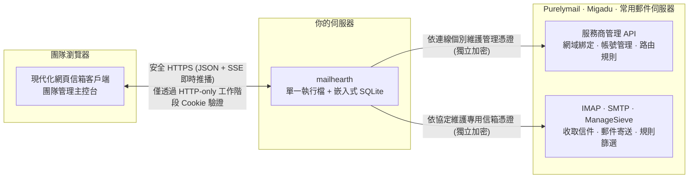

# Mailhearth

[English](README.md) · [简体中文](README.zh-CN.md) · **繁體中文** · [日本語](README.ja.md) · [Español](README.es.md)

**Mailhearth** 是專為小型團隊（1–50 人）量身打造的輕量級自架商務電子郵件平台，特別適合新創團隊、獨立開發者、工作室與中小型組織。它能夠統一連接 Purelymail、Migadu 以及自建或標準 IMAP/SMTP 郵件伺服器，將組織架構、成員角色、個人信箱、團隊共用信箱、郵件別名、群組清單、自訂網域及現代化 Web 網頁信箱無縫整合於單一系統中。

在系統架構上，底層郵件伺服器專注於信件的穩定遞送、網路傳輸與實體儲存；Mailhearth 則在頂層負責團隊組織模型、精細權限控制、日常維運管理及流暢直覺的使用者體驗。系統對服務商的管理 API 憑證與各信箱的底層協定憑證進行嚴密隔離管理。



Mailhearth 嚴格遵循安全性隔離規範：一般的管理查詢絕不會以明文回傳任何已儲存的 API Token 或信箱密碼；為外部第三方用戶端新建立的應用程式專用密碼，必須由獲授權的管理員透過受限的一次性通道明確領取。

| 網頁信箱用戶端 | 管理主控台 |
|---|---|
|  |  |
|  |  |

<sub>註：上述螢幕截圖擷取自本機內建的文件示範環境，展示介面版面與互動設計，不代表真實外部郵件服務商的連線驗證狀態。</sub>

## 核心功能與特性

**對於團隊管理者與管理員**

- **極簡首次啟動精靈**：快速建立組織並連接郵件服務商，一鍵探索遠端既有資源並彈性選擇匯入，隨後依需求設定信箱憑證，或先跳過信箱綁定直接完成初始化。資源匯入全程採唯讀模式，絕不會破壞性變更遠端服務資料。
- **以「人」為中心的成員管理**：依自然人的直覺維度管理團隊成員——姓名、角色、所屬部門、建立專屬新信箱或綁定既有信箱、分配共用信箱權限、加入郵件群組，並可產生具安全有效期限的專屬邀請連結。
- **多人協同處理的共用信箱**：多名團隊成員可同時協作處理客服（`support@`）或業務（`sales@`）等公共信箱，成員無需知曉底層真實密碼即可直接作業；權限支援精準細分為「完整存取」、「可讀可寄」或「唯讀」。
- **彈性完整的地址管理**：完整支援別名（Alias）、郵件轉寄（Forwarding）、全收地址（Catch-all）與前綴地址（Prefix），以及能自動跟隨部門/群組成員動態更新的郵件群組發信清單。
- **完善的成員離職交接流程（Offboarding）**：安全沉澱各項離職交接動作——將信箱平順移交給指定接手人或保留封存、自動自團隊群組中移除、立即終止並清除所有作用中的工作階段；若服務商支援遠端撤銷，系統將協助執行並完整記錄管理員的處理報告。
- **網域與 DNS 狀態監控**：視覺化監控自訂網域的 DNS 解析健康狀態（MX、SPF、DKIM、DMARC），並提供一鍵複製的標準 DNS 設定記錄值。
- **多層級角色與完整稽核記錄**：內建豐富的權限控管規則，系統內所有敏感操作均提供完整的稽核軌跡記錄（Audit Log），並支援無縫移轉組織所有權。

**對於全體團隊使用者**

- **極速反應的現代化 Web 網頁信箱**：具備系統與自訂資料夾、分頁瀏覽、伺服器端極速搜尋、星號標記、批次整理、附件預覽與下載、草稿即時自動儲存、豐富文字編輯與個人簽名檔、多重寄件身分自由切換、基於 IMAP IDLE 的即時桌面通知、全域鍵盤快速鍵、淺色與深色主題自由切換，並完整支援 5 種語言介面。
- **團隊協同作業**：信件處理狀態一目了然——即時檢視該封郵件是否已有隊友回覆、將郵件直接指派給特定負責人、標記處理進度，以及在郵件下方新增僅內部可見的私密團隊備註。
- **自動化郵件規則與自動回覆**：在支援 ManageSieve 協定的郵件伺服器上自由設定自動化篩選規則與休假自動回覆。系統會主動保留伺服器上的既有指令碼，並在接管當前活躍指令碼時提示確認。
- **嚴謹可靠的信件傳遞機制**：寄送請求將 SMTP 傳輸與寄件備份（Sent Copy）作為獨立步驟持久化記錄。未知投遞結果絕不盲目重複投遞，若寄件備份儲存失敗僅重試寫入備份，徹底杜絕重複寄信給客戶的意外。

**堅實的安全性架構**

- **全鏈路靜態加密儲存**：所有服務商管理 API 憑證與信箱協定密碼均採用 AES-256-GCM 高強度演算法加密儲存於資料庫中，金鑰由伺服器端 master.key 安全衍生，絕不外流至瀏覽器端。
- **嚴格的內容沙箱防禦**：郵件內文 HTML 在伺服器端經過嚴密消毒處理，並在啟用嚴格 CSP（內容安全政策）的無指令碼沙箱 iframe 中安全呈現；預設封鎖遠端外部圖片以防追蹤，由使用者自主決定是否載入；附件強制附加 `X-Content-Type-Options: nosniff` 標頭並以安全下載模式提供。
- **企業級基礎防護體系**：內建嚴格的 CSRF 防禦、防止暴力破解的登入速率限制、基於 argon2id 的高強度密碼雜湊雜湊演算法，以及不可竄改的操作稽核日誌。

## 系統需求

- **郵件服務支援**：一個用於 API 自動化管理的 Purelymail 或 Migadu 帳戶；或是用於手動連線的自建/第三方標準信箱（具備 IMAP/SMTP 存取憑證即可，ManageSieve 為選配）。
- **輕量伺服器規格**：一台普通的 Linux 主機（512 MB 記憶體即可流暢運作，執行檔閒置記憶體僅約 30 MB 左右），以及一個負責終止 TLS 憑證的反向代理（建議使用 Caddy、Nginx 或 Traefik）。

## 快速開始與部署

使用 Docker Compose（推薦方式）：

```bash
git clone https://github.com/yll682/Mailhearth.git && cd Mailhearth
cp .env.example .env            # 編輯 .env 檔案，將 MAILHEARTH_BASE_URL 設為你的公開網址
docker compose up -d --build
```

`--build` 會建置目前簽出的程式碼；如需執行已發行的版本，請改用 `docker compose pull && docker compose up -d`（compose 檔案固定使用 `0.2` 發行線）。

服務啟動後，請先從日誌中讀取一次性初始化權杖（`docker compose logs mailhearth | grep 'FIRST-TIME SETUP'`），或透過 `MAILHEARTH_SETUP_TOKEN` 自行設定，接著在瀏覽器中開啟設定好的公開網址，跟隨首次執行精靈建立組織管理員、新增郵件連線並依需求匯入信箱資源。在正式收發郵件前，請確認各協定憑證已設定完成並通過連通性檢查。

> **資料備份提示**：請定期備份掛載的 `/data` 資料磁碟區，系統核心的 SQLite 資料庫檔案以及主加密金鑰 `master.key` 皆儲存於該目錄中。

若偏好直接以二進位執行檔運行，執行 `make build` 即可編譯出內嵌全部 Web 靜態資源的獨立單一執行檔 `mailhearth`，使用 `MAILHEARTH_DATA_DIR=/var/lib/mailhearth ./mailhearth` 即可直接啟動。

## 使用既有 IMAP/SMTP 信箱

在管理主控台中選擇「手動連線」，登記完整信箱地址，並分別填寫啟用的 IMAP、SMTP（以及選用的 ManageSieve）伺服器主機名稱、連接埠、TLS 安全模式與登入密碼。

- IMAP 與 SMTP 允許使用完全獨立的使用者名稱與密碼。
- 若伺服器未提供 ManageSieve 協定，直接在設定中停用該項即可。
- TLS 憑證驗證預設使用作業系統內建的信任 CA 憑證，同時支援明確掛載自訂的專用私有 CA 憑證包。
- 匯入轉寄規則時，系統會完整保留原始來源、各目標確認狀態及遠端參照；未驗證的投遞方式將保持 `unverified` 標記，其中 Migadu 轉寄寫入需要通過嚴格的投遞驗證。

## 系統組態設定

Mailhearth 遵循 12-Factor 原則，所有設定皆透過環境變數管理，詳見 [`.env.example`](.env.example)。在多數正式生產環境中，你通常僅需設定以下兩項：
- `MAILHEARTH_BASE_URL`：外部使用者存取 Mailhearth 的完整公開基礎 URL。
- `MAILHEARTH_TRUST_PROXY`：部署在反向代理之後時設為 `true`，系統會從 `X-Forwarded-For` 讀取用戶端位址。轉送標頭僅在請求來自 `MAILHEARTH_TRUSTED_PROXIES` 所列代理（預設：本機迴路與私有網段）時才會被採信。

設定值格式錯誤或超出範圍時，系統會在啟動時報錯並指明對應變數。全部設定項（包括上傳配額、工作階段有效期、郵件伺服器網路白名單與私有 CA 憑證）請見[系統維運手冊](docs/operations.zh-TW.md)中的「設定項參考」一節。

## 深入技術文件

- [系統架構指南](docs/architecture.zh-TW.md)：深入探討 Mailhearth 內部架構、領域資料模型、郵件連線抽象化與非同步持久化作業機制。
- [安全性規範說明](docs/security.zh-TW.md)：系統威脅模型、深度防禦機制及各項安全保護措施詳細解析。
- [維運作業手冊](docs/operations.zh-TW.md)：日常維護作業、資料庫備份與還原、版本無縫升級、容量規劃與常見問題診斷。
- [版本變更記錄](CHANGELOG.zh-TW.md)：記錄各版本的發布內容、新功能亮點、使用體驗最佳化與錯誤修復。

## 參與開發

```bash
go test ./... -run '^$'
go test -count=1 ./... -run '^TestMultiProvider'
go vet ./...
npm --prefix web run typecheck
npm --prefix web run test
npm --prefix web run build
cd web && npm run dev           # 啟動 Vite 開發伺服器，將 /api 自動代理至 :8080
```

技術棧：Go 1.27 + Preact + Vite + SQLite（純 Go 驅動程式，零 cgo 相依）。前端與後端代碼皆緊湊編譯打包至單一執行檔中。

前端介面原生支援英文、簡體中文、繁體中文（台灣）、日文與西班牙文共 5 種語言。所有字串字典皆維護於 [`web/src/lib/i18n.ts`](web/src/lib/i18n.ts) 中：以英文作為標準源語言，擴充新語言僅需新增一組字典對應並在語言切換選單中聲明。執行 `web/tests/i18n.test.mjs` 可全量驗證多語言詞條覆蓋率與變數插值對稱性。

## 開源授權條款

本專案採用 MIT 開源授權條款釋出，完整條款請參閱 [LICENSE](LICENSE) 檔案。
